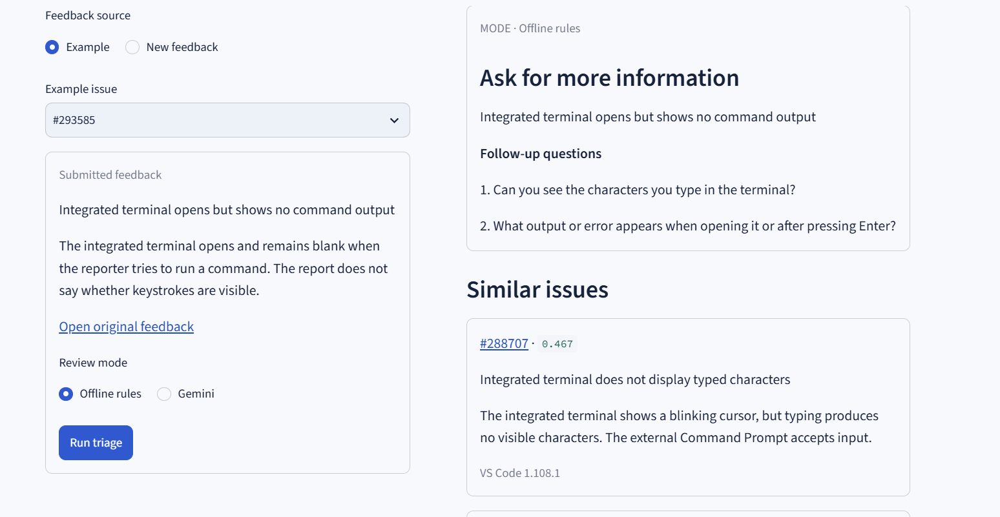
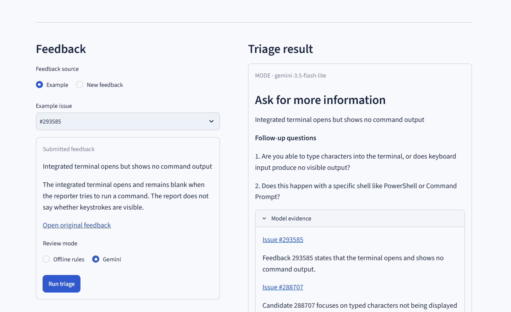

# 客户反馈分流 Agent

面向 SaaS 客服和产品运营的反馈初筛工具。输入一条反馈，程序找出最多三条历史工单，并建议关联已有工单、补充关键信息或新建工单。网页提供候选原文、追问和可编辑的交接摘要，供经办人核对。

当前演示范围为 VS Code 集成终端，使用公开 GitHub 工单的英文摘要和链接。

## 快速开始

使用 Python 3.12 或 3.13。在 GitHub 选择 **Code → Download ZIP** 后解压，或用 Git 克隆仓库。进入含 `app.py` 和 `requirements.txt` 的目录，运行：

```bash
python -m pip install -r requirements.txt
python -m streamlit run app.py
```

打开终端显示的 **Local URL**。保留 **Example → #293585 → Offline rules**，点击 **Run triage**。安装依赖后，离线模式可直接在本机运行。

### 网页演示

样例 [#293585](https://github.com/microsoft/vscode/issues/293585) 报告尝试在终端运行命令时没有输出。第一名候选 [#288707](https://github.com/microsoft/vscode/issues/288707) 描述的是键入的字符看不见。页面给出 **Ask for more information**，请经办人先确认字符是否可见，再决定怎样处理。



<details>
<summary>查看 Gemini 主案例实测截图</summary>



</details>

两张截图均来自 Day 7 的 Windows 本机演示。当前版本还可以选择 **New feedback** 输入英文反馈。提交后在 **Handoff summary** 核对、编辑并复制交接草稿。

## 使用 Gemini

在启动应用的同一个终端设置 `GEMINI_API_KEY`。Windows PowerShell 可使用隐藏输入：

```powershell
$env:GEMINI_API_KEY = [System.Net.NetworkCredential]::new("", (Read-Host "Gemini API Key" -AsSecureString)).Password
python -m streamlit run app.py
```

网页选择 **Gemini** 再提交。当前反馈和最多三条候选会发给模型，默认模型为 `gemini-3.5-flash-lite`。需要切换到账号可用且支持结构化输出的模型时，设置 `GEMINI_MODEL`。请求失败时，**Run offline rules** 可用同一条已提交反馈运行离线规则。

也可以在终端直接试主案例：

```bash
python triage.py 293585
python triage.py 293585 --online
```

## 效果评估与复跑

12 条预先确定的独立样例，在「建议关联」「先补信息」「建议新建」三类各 4 条。两种模式共用 30 条种子工单与 4 条评估专用工单，按每条反馈的提交时间筛选历史记录。

| 指标 | 离线规则 | Gemini 3.5 Flash Lite |
| --- | ---: | ---: |
| 分流动作正确 | 4/12 | 10/12 |
| 参考工单排第一 | 4/4 | 4/4 |
| 正确关联到参考工单 | 0/4 | 4/4 |
| 应补信息且判断正确 | 4/4 | 2/4 |
| 应新建且判断正确 | 0/4 | 4/4 |

两种模式的候选和相似度逐项一致。离线规则把 12 条都判为先补信息。Gemini 的两条错误是把仍缺复现细节的反馈建议新建。4 条参考工单均已收入评估库。逐例输出、失败原因和指标分母见 [Day 10 评估记录](eval/day10_results.md)。

```bash
python evaluate.py --output day10-offline.json
python evaluate.py --online --output day10-gemini.json
python -m unittest discover -s tests -v
```

前两条命令生成逐例 JSON，在线命令使用同一终端的 `GEMINI_API_KEY`。最后一条运行自动测试。评估脚本先完成全部预测，再读取参考答案。工单字段、样例来源和参考答案见[数据说明](data/README.md)。

## 发布前自动验收

PR 更新和推送 main 后，GitHub Actions 会在 Windows / Linux、Python 3.12 / 3.13 运行测试、主案例和冻结评估。流程使用离线模式，无需 Gemini 密钥，并保存各环境的评估 JSON 与实际依赖版本清单。验收门槛、复跑命令和查看方法见 [Day 14 开发说明](docs/day14-verification.md)。

## 分流是怎么做的

1. **筛历史**。只查反馈提交前已经存在的工单。
2. **找候选**。用工单标题和症状摘要做 TF-IDF 向量化，再用余弦相似度取最多三条正分候选。
3. **给建议**。离线模式按首位候选的分数和 VS Code 版本执行规则。Gemini 比较候选的症状、触发条件和缺失信息。程序校验关联编号及证据引用，按已有记录补上链接。

离线规则的关联条件是相似度达到 0.45 且双方有相同的 VS Code 版本。其余达到 0.25 的情况先追问。低于 0.25 或没有候选时，有复现步骤则建议新建，否则先追问。网页和命令行共用同一套分流函数。

| 入口 | 用途 |
| --- | --- |
| [`app.py`](app.py) | Streamlit 网页和交接摘要 |
| [`triage.py`](triage.py) | 搜索候选、分流和单例命令行 |
| [`history.py`](history.py) | 按提交时间筛选历史工单 |
| [`model_review.py`](model_review.py) | 调用 Gemini 并核对返回内容 |
| [`evaluate.py`](evaluate.py) | 独立评估、汇总和逐例输出 |

## 许可证与版本

项目代码采用 [MIT 许可证](LICENSE)。样例和评估数据保留了公开工单的原文链接及标注依据。[数据说明](data/README.md)

首版功能、评估与运行方法见 [v0.1.0 发布说明](RELEASE_NOTES.md)。当前已完成验收，版本标签与 GitHub Release 待创建，状态及操作见 [Day 15 发布记录](docs/day15-release.md)。

## 开发记录

<details>
<summary>展开 Day 1–15</summary>

| 阶段 | 进度 |
| --- | --- |
| Day 1 | 确定业务范围、三类分流建议和演示案例。[PR #1](https://github.com/takahashifuwari/feedback-triage-agent/pull/1) |
| Day 2 | 整理 4 条种子工单、4 条练习反馈和 4 条参考答案。[PR #2](https://github.com/takahashifuwari/feedback-triage-agent/pull/2) |
| Day 3 | 补到 30 条候选并按提交时间过滤。用 `python history.py 293585` 可复跑，30 条中有 28 条早于该反馈。 |
| Day 4 | 加入 TF-IDF 和分流规则。开发样例 #303822 的参考工单 #303202 排第七，未进前三。 |
| Day 5 | 跑通离线演示，验证动作类别及关联编号。 |
| Day 6 | 接入 Gemini，返回证据和追问。 |
| Day 7 | 搭建 Streamlit 网页并完成 Windows 上的离线和 Gemini 验证。 |
| Day 8 | 加入离线重试、空候选提示和可编辑的交接摘要。 |
| Day 9 | 冻结 12 条独立评估反馈及参考答案。 |
| Day 10 | 复跑离线规则与 Gemini，记录逐例结果和失败原因。 |
| Day 11 | 整理快速开始、演示截图、评估复现说明。 |
| Day 12 | 在全新的 Python 环境完成安装、启动与离线评估，16 项测试通过。 |
| Day 13 | 准备首版许可证与发布说明。 |
| Day 14 | 加入跨环境自动验收与冻结评估回归门槛，PR #14 已合并，本机验收通过。 |
| Day 15 | 核对 main 四组验收并归档逐例结果与依赖版本，准备首版发布。[发布记录](docs/day15-release.md) |

</details>


